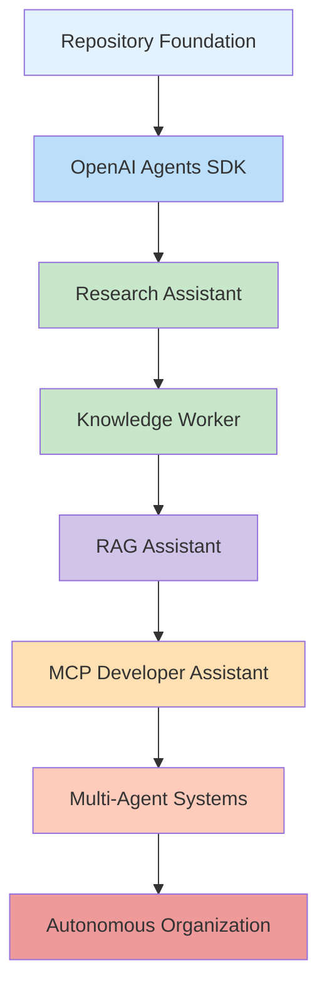
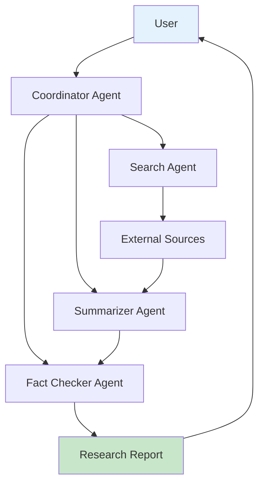
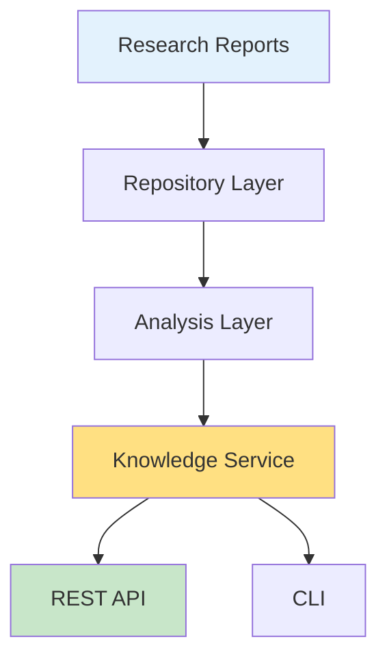
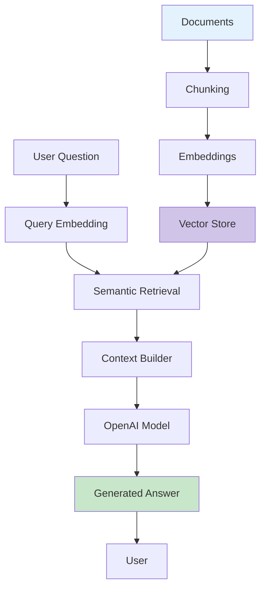
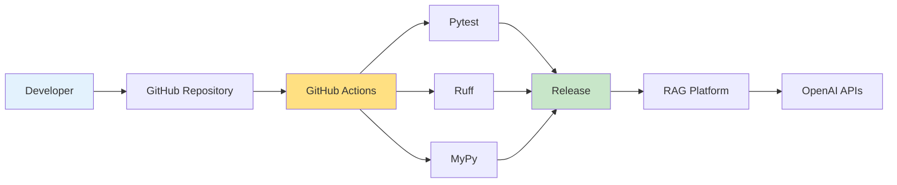
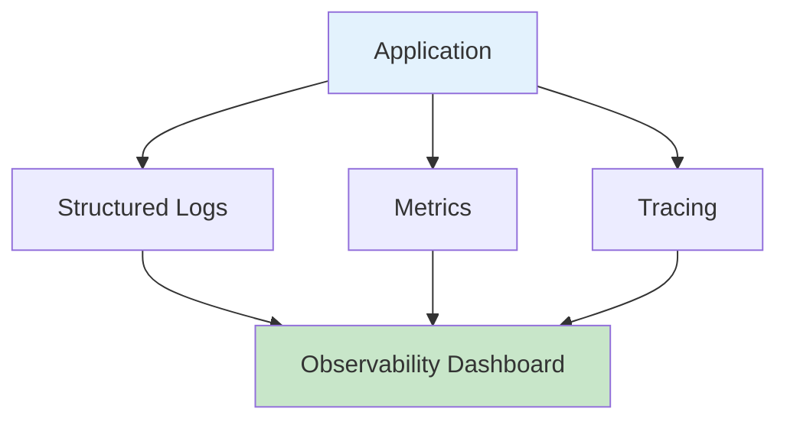
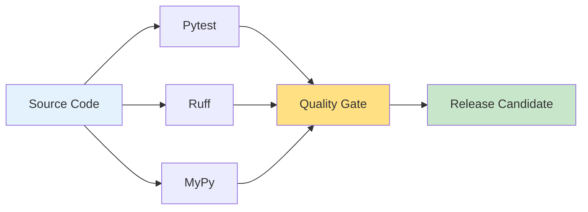
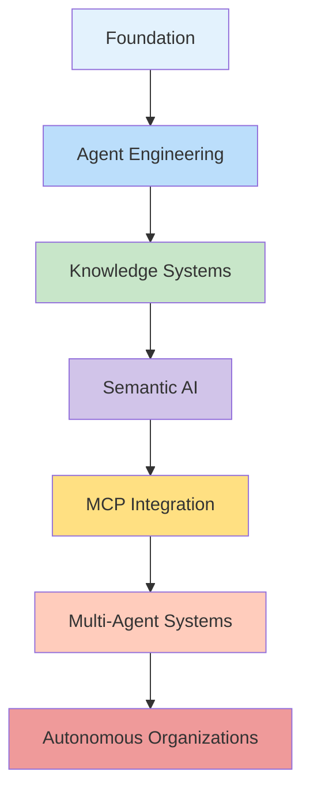
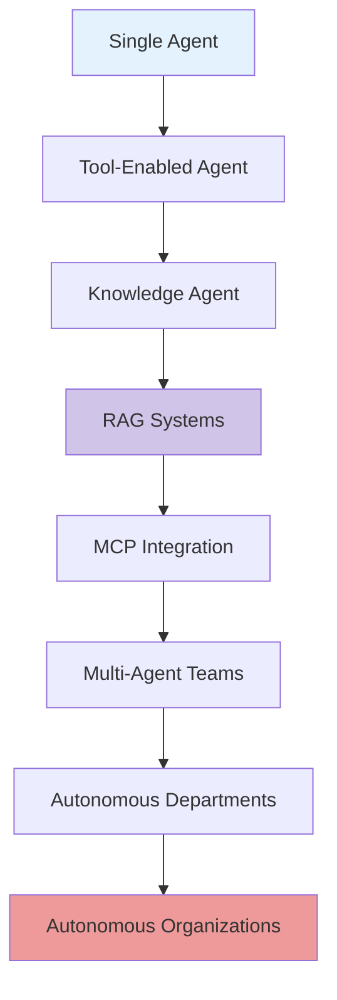

# 🤖 Autonomous AI Agents Hub

[](https://github.com/gtaltou/autonomous-ai-agents-hub/actions/workflows/ci.yml)


---

## Executive Summary

**Autonomous AI Agents Hub** is a strategic engineering portfolio dedicated to the design, implementation, evaluation, deployment and operation of modern AI systems.

The repository documents a progressive journey from foundational agent architectures to advanced autonomous organizations using:

- OpenAI Agents SDK
- Retrieval-Augmented Generation (RAG)
- Model Context Protocol (MCP)
- LangGraph
- CrewAI
- AutoGen
- Multi-Agent Architectures

The objective is to build production-oriented AI systems while maintaining professional software engineering standards, including testing, continuous integration, observability, deployment readiness and architectural governance.

---

# 📚 Table of Contents

- [🚀 Portfolio Overview](#-portfolio-overview)
- [📈 Program Evolution](#-program-evolution)
- [🏛 Architecture Overview](#-architecture-overview)
- [🧩 Core Architecture Components](#-core-architecture-components)
- [🔄 Data Flow Architecture](#-data-flow-architecture)
- [🚀 Deployment Architecture](#-deployment-architecture)
- [🌍 Environment Strategy](#-environment-strategy)
- [🔄 Rollback Strategy](#-rollback-strategy)

# 🚀 Portfolio Overview

| Project | Purpose | Status |
|----------|----------|----------|
| Research Assistant | Multi-Agent Research Platform | ✅ Released |
| Knowledge Worker | Knowledge Analytics Platform | ✅ Released |
| RAG Assistant | Semantic Retrieval Platform | ✅ Released |
| MCP Developer Assistant | Tool-Augmented Engineering Copilot | 🚧 In Progress |
| Code Review Agent | Automated Code Quality Platform | ⏳ Planned |
| Customer Support Agent | RAG-Enabled Support Platform | ⏳ Planned |
| Content Factory | Autonomous Content Production | ⏳ Planned |
| Recruiting Agent | Candidate Intelligence Platform | ⏳ Planned |
| Autonomous Team | Collaborative AI Workforce | ⏳ Planned |
| Software Engineering Team | Autonomous Software Delivery | ⏳ Planned |
| Autonomous Organization | End-to-End Agent Ecosystem | ⏳ Planned |

---


# 📈 Program Progress

| Domain | Progress |
|:---|:---:|
| Repository Foundation | 🟩🟩🟩🟩🟩🟩🟩🟩🟩🟩 100% |
| OpenAI Agents SDK | 🟩🟩🟩🟩🟩🟩🟩🟩🟩🟩 100% |
| Research Assistant | 🟩🟩🟩🟩🟩🟩🟩🟩🟩🟩 100% |
| Knowledge Worker | 🟩🟩🟩🟩🟩🟩🟩🟩🟩🟩 100% |
| REST API Engineering | 🟩🟩🟩🟩🟩🟩🟩🟩🟩🟩 100% |
| DevOps & Delivery | 🟩🟩🟩🟩🟩🟩🟩🟩🟩🟩 100% |
| RAG Systems | 🟩🟩🟩🟩🟩🟩🟩🟩🟩🟩 100% |
| MCP Ecosystem | 🟩⬜⬜⬜⬜⬜⬜⬜⬜⬜ 10% |
| LangGraph | ⬜⬜⬜⬜⬜⬜⬜⬜⬜⬜ 0% |
| CrewAI | ⬜⬜⬜⬜⬜⬜⬜⬜⬜⬜ 0% |
| AutoGen | ⬜⬜⬜⬜⬜⬜⬜⬜⬜⬜ 0% |


---

# 📈 Program Evolution



---

# 🏛 Architecture Overview

The repository follows a layered architecture strategy designed to progressively evolve from individual AI capabilities to fully autonomous organizations.

## Architectural Domains

| Domain | Objective |
|----------|----------|
| Foundation | Engineering Standards & Tooling |
| Agent Engineering | Agent Lifecycle Management |
| Knowledge Systems | Analytics & Knowledge Reuse |
| Semantic AI | Embeddings & Retrieval |
| MCP Integration | Tool-Augmented Agents |
| Multi-Agent Systems | Collaboration & Orchestration |
| Autonomous Organizations | End-to-End AI Workforce |

---

# 🧩 Core Architecture Components

## Foundation Layer

```text
Repository Structure
Documentation
Quality Gates
Testing Framework
CI/CD
Containerization
```

## Agent Engineering Layer

```text
Agents
Tools
Structured Outputs
Evaluations
Workflows
```

## Knowledge Layer

```text
Repositories
Analyzers
Knowledge Services
REST APIs
```

## Semantic Layer

```text
Chunking
Embeddings
Caching
Vector Stores
Semantic Retrieval
RAG Pipelines
```

## Integration Layer

```text
MCP
GitHub
Filesystem
External APIs
Enterprise Systems
```

## Collaboration Layer

```text
Coordinator Agents
Specialized Agents
Shared Context
Task Delegation
Collaborative Execution
```

---

# 🔄 Data Flow Architecture

## Research Workflow



---

## Knowledge Workflow



---

## Semantic Retrieval Workflow



---

# 🚀 Deployment Architecture



-erimentation
- Local Validation

**Infrastructure**

```text
Python
Virtual Environment
Local Runtime
```

## Staging

**Purpose**

- Integration Testing
- Release Validation

**Infrastructure**

```text
Docker
GitHub Actions
Automated Validation
```

## Production

**Target Architecture**

```text
FastAPI
Vector Database
Persistent Cache
Monitoring
Container Platform
```

---


# 📊 Observability & Metrics

The platform progressively introduces observability practices aligned with modern AI platform engineering.

## Observability Architecture



## Engineering Metrics

```text
Tests Passed
Coverage %
Build Success Rate
Release Frequency
Pull Request Validation
```

## AI Metrics

```text
Embedding Requests
Cache Hit Rate
Retrieval Latency
Response Time
Token Consumption
Similarity Scores
```

## Platform Metrics

```text
Availability
Error Rate
Deployment Success Rate
Recovery Time
System Health
```

## Current Quality Baseline

```text
Knowledge Worker
-------------
70 Tests
92% Coverage
Docker
GitHub Actions

RAG Assistant
-------------
34 Tests
100% Coverage
Ruff Passing
MyPy Passing

Repository
----------
CI/CD Enabled
Versioned Releases
Automated Validation
```

---

# 🛠 Technology Stack

| Category | Technologies |
|-----------|-----------|
| Language | Python 3.12 |
| Agent Frameworks | OpenAI Agents SDK, CrewAI, LangGraph, AutoGen |
| Protocols | MCP |
| RAG | OpenAI Embeddings, ChromaDB, FAISS |
| APIs | FastAPI |
| Validation | Pytest, Ruff, MyPy |
| CI/CD | GitHub Actions |
| Containers | Docker |
| Package Manager | uv |
| Observability | OpenTelemetry, LangSmith |

---

# 📂 Repository Structure

```text
autonomous-ai-agents-hub
│
├── examples/
│   └── beginner/
│       ├── hello-agent/
│       ├── tool-calling/
│       ├── structured-output/
│       └── evaluation/
│
├── projects/
│   ├── research-assistant/
│   ├── knowledge-worker/
│   ├── rag-assistant/
│   ├── developer-assistant/
│   ├── code-review-agent/
│   ├── customer-support-agent/
│   ├── content-factory/
│   ├── recruiting-agent/
│   ├── autonomous-team/
│   ├── software-engineering-team/
│   └── autonomous-organization/
│
├── docs/
│
├── .github/
│
├── README.md
├── ROADMAP.md
├── CHANGELOG.md
├── LICENSE
└── pyproject.toml
```

---

# ✅ Delivered Projects

## 🔍 Research Assistant

Production-oriented multi-agent research platform built on OpenAI Agents SDK.

### Capabilities

```text
Coordinator Agent
Search Agent
Summarizer Agent
Fact Checker Agent
Structured Outputs
Evaluation Framework
Report Repository
Markdown Reporting
```

### Outcome

```text
First production-ready multi-agent system delivered.
```

---

## 📚 Knowledge Worker

Knowledge analytics and exploitation platform built on top of research outputs.

### Capabilities

```text
Topic Discovery
Top Topics
Recommendations
Related Reports
JSON Export
REST API
OpenAPI
Swagger UI
Docker
CI/CD
```

### Quality

```text
70 Tests
92% Coverage
Ruff Passing
Docker Support
GitHub Actions
```

### Status

```text
Released
```

---

## 🧠 RAG Assistant

Semantic Retrieval-Augmented Generation platform.

### Capabilities

```text
Text Chunking
OpenAI Embeddings
Cached Embeddings
Semantic Retrieval
Vector Similarity Search
Semantic Vector Store
Semantic RAG Pipeline
End-to-End Retrieval Workflow
```

### Quality

```text
34 Tests
100% Coverage
Ruff Passing
MyPy Passing
```

### Status

```text
Released
```

---

# 🏆 Engineering Standards

All projects follow consistent engineering principles.

## Architecture

```text
Layered Architecture
Separation of Concerns
Dependency Injection
Modular Design
```

## Quality

```text
Unit Tests
Integration Tests
End-to-End Validation
Type Safety
Static Analysis
```

## Delivery

```text
CI/CD
Docker
GitHub Actions
Versioned Releases
Documentation
```

## Governance

```text
Roadmap-Driven Development
Architecture Documentation
Release Management
Continuous Improvement
```

---

# ✅ Quality Gates

The repository enforces automated quality validation before changes reach production-ready status.



### Validation Stack

```text
Unit Tests
Integration Tests
API Tests
Coverage Validation
Static Analysis
Type Checking
CI/CD Verification
```

---

# ⚡ Quick Start

## Clone Repository

```bash
git clone https://github.com/gtaltou/autonomous-ai-agents-hub.git

cd autonomous-ai-agents-hub
```

## Create Environment

```bash
uv venv
```

### Windows

```bash
.venv\Scripts\activate
```

### Linux / macOS

```bash
source .venv/bin/activate
```

## Install Dependencies

```bash
uv sync
```

---

# 🔧 Installation

## Prerequisites

```text
Python 3.12+
Git
uv
OpenAI API Key
```

## Install Dependencies

```bash
uv sync
```

## Run Tests

```bash
pytest
```

## Run Ruff

```bash
ruff check .
```

## Run MyPy

```bash
mypy .
```

---

# 📚 Documentation

| Document | Purpose |
|-----------|-----------|
| `ROADMAP.md` | Strategic roadmap and future milestones |
| `CHANGELOG.md` | Release history |
| `examples/` | Foundational examples and learning assets |
| `projects/` | Production-oriented AI applications |
| `docs/` | Technical documentation |

---

# 📈 Repository Evolution



---

# 🤝 Contributing

Contributions, feedback and architectural discussions are welcome.

Examples of valuable contributions:

- New AI agent projects
- MCP integrations
- RAG enhancements
- Evaluation frameworks
- Testing strategies
- Documentation improvements
- Engineering best practices

Please open an issue or submit a pull request to contribute.

---

# 📄 License

This repository is distributed under the MIT License.

See the `LICENSE` file for additional details.

---

# 🚀 Mission

> Design, build, evaluate, deploy and operate production-grade AI systems while progressing from individual intelligent agents to fully autonomous organizations.



---

**Autonomous AI Agents Hub** is both an engineering portfolio and a long-term exploration of Agentic AI, Retrieval-Augmented Generation, tool-enabled systems, workflow orchestration and autonomous organizational architectures.