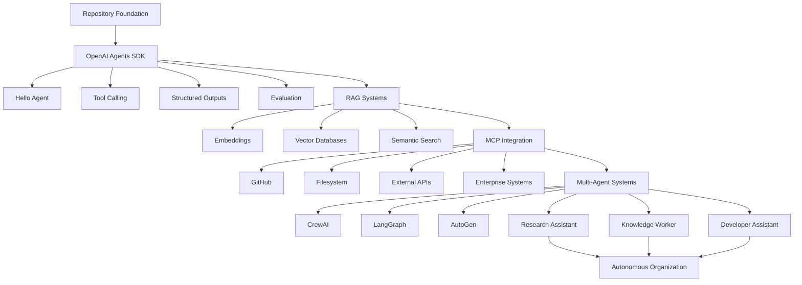
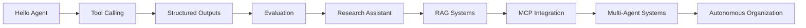
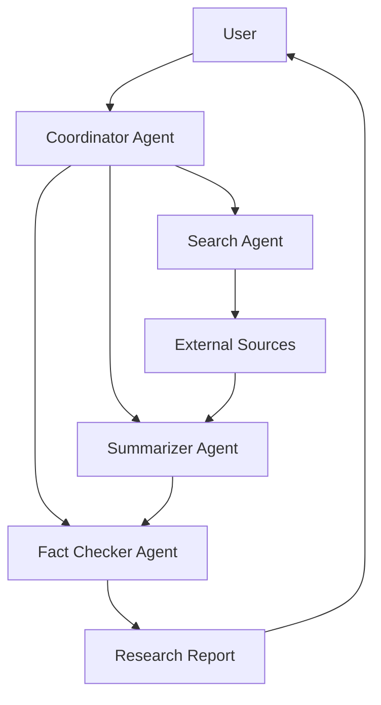

# 🤖 Autonomous AI Agents Hub

A structured engineering roadmap focused on designing, evaluating and deploying production-ready AI agent systems.

This repository documents the progressive implementation of modern Agentic AI architectures, from OpenAI Agents SDK fundamentals to advanced multi-agent ecosystems powered by RAG, MCP, LangGraph, CrewAI and AutoGen.

---

## 🚀 Architecture & Projects Roadmap

| ID | Project | Business Objective | Core Technologies | Status |
|:---:|:---|:---|:---|:---:|
| 01 | 🔍 `./projects/research-assistant/` | Multi-agent research and fact verification | OpenAI Agents SDK, Handoffs, Structured Outputs | 🚧 |
| 02 | 📚 `./projects/knowledge-worker/` | Enterprise knowledge retrieval | RAG, Embeddings, ChromaDB | ⏳ |
| 03 | 🔧 `./projects/developer-assistant/` | AI-powered engineering copilot | MCP, GitHub, Filesystem Tools | ⏳ |
| 04 | 💻 `./projects/code-review-agent/` | Automated code quality analysis | OpenAI Agents SDK, Evaluation | ⏳ |
| 05 | 🎧 `./projects/customer-support-agent/` | Intelligent support platform | RAG, MCP, Memory | ⏳ |
| 06 | ✍️ `./projects/content-factory/` | AI content production pipeline | CrewAI, Multi-Agent Workflows | ⏳ |
| 07 | 🏢 `./projects/recruiting-agent/` | Resume screening and candidate ranking | Embeddings, RAG, Classification | ⏳ |
| 08 | 🤝 `./projects/autonomous-team/` | Multi-role AI collaboration | LangGraph, State Management | ⏳ |
| 09 | ⚙️ `./projects/software-engineering-team/` | Autonomous software delivery | AutoGen, Agent Delegation | ⏳ |
| 10 | 🌐 `./projects/autonomous-organization/` | End-to-end AI workforce | LangGraph + MCP + RAG + Memory | ⏳ |

---

## 🏛 Detailed Architecture

The repository follows a progressive engineering roadmap, moving from foundational agent concepts to enterprise-grade autonomous systems.



### Architectural Layers

| Layer | Purpose |
|:---|:---|
| Repository Foundation | Engineering standards, testing, CI/CD |
| OpenAI Agents SDK | Agent lifecycle, tools, structured outputs |
| RAG Systems | Knowledge retrieval and memory |
| MCP Integration | Real-world external systems |
| Multi-Agent Systems | Agent collaboration and orchestration |
| Autonomous Organization | End-to-end AI workforce |

---

## 🏗 Engineering Roadmap

| Stage | Focus | Technologies |
|:---|:---|:---|
| 🟢 Foundation | Single-Agent Systems | OpenAI Agents SDK |
| 🔵 Knowledge Systems | Retrieval & Memory | Embeddings, RAG, ChromaDB |
| 🟣 External Integrations | Tool-Based Agents | MCP |
| 🟠 Multi-Agent Collaboration | Autonomous Teams | CrewAI, AutoGen |
| 🔴 Workflow Orchestration | Stateful Agent Systems | LangGraph |
| ⚫ Production Engineering | Monitoring & Evaluation | LangSmith, OpenTelemetry |

---

## ✅ Implemented Foundations

### OpenAI Agents SDK Fundamentals

| Example | Description | Location |
|:---|:---|:---|
| Hello Agent | First OpenAI Agent implementation | `examples/beginner/hello-agent/` |
| Tool Calling | Tool-enabled agent using Function Tools | `examples/beginner/tool-calling/` |
| Structured Outputs | Typed responses using Pydantic models | `examples/beginner/structured-output/` |
| Evaluation | Automated output validation and scoring | `examples/beginner/evaluation/` |

**Status:** ✅ Completed (4/4)

---

## 📦 Releases

| Version | Milestone |
|:---:|:---|
| v0.1.0 | Repository Foundation |
| v0.2.0 | Hello Agent |
| v0.3.0 | Tool Calling |
| v0.4.0 | Structured Outputs |
| v0.5.0 | Evaluation |


## 🛠 Tech Stack

| Category | Technologies |
|:---|:---|
| LLM Providers | OpenAI, Anthropic, Groq |
| Agent Frameworks | OpenAI Agents SDK, CrewAI, LangGraph, AutoGen |
| Protocols | MCP |
| RAG Frameworks | LangChain, LlamaIndex |
| Vector Databases | ChromaDB, FAISS |
| Observability | LangSmith, OpenTelemetry |
| Infrastructure | Docker, GitHub Actions |
| Language | Python 3.12 |
| Package Manager | uv |

---

## 🚧 Active Development

### Sprint 03 — Research Assistant

The first end-to-end AI system developed within the Autonomous AI Agents Hub roadmap.

| Component | Responsibility |
|:---|:---|
| Coordinator Agent | Orchestrates the workflow |
| Search Agent | Collects information |
| Summarizer Agent | Synthesizes findings |
| Fact Checker Agent | Validates information quality |

```text
User
 │
 ▼
Coordinator Agent
 │
 ├── Search Agent
 ├── Summarizer Agent
 └── Fact Checker Agent
```

**Goal:** Build a complete multi-agent research workflow using OpenAI Agents SDK.

---

## 📂 Repository Structure

```text
autonomous-ai-agents-hub
│
├── examples/
│   └── beginner/
│       ├── hello-agent/
│       ├── tool-calling/
│       ├── structured-output/
│       └── evaluation/
│
├── projects/
│   ├── research-assistant/
│   ├── knowledge-worker/
│   ├── developer-assistant/
│   ├── code-review-agent/
│   ├── customer-support-agent/
│   ├── content-factory/
│   ├── recruiting-agent/
│   ├── autonomous-team/
│   ├── software-engineering-team/
│   └── autonomous-organization/
│
├── docs/
├── .github/
│
├── README.md
├── ROADMAP.md
├── requirements.txt
└── LICENSE
```

---

## 🎯 Technical Capabilities

| Domain | Skills |
|:---|:---|
| Agent Engineering | Agents, Handoffs, Tool Calling |
| Structured AI Outputs | Pydantic, Validation, Output Schemas |
| AI Evaluation | Scoring, Quality Gates, Validation |
| Knowledge Systems | RAG, Embeddings, Vector Search |
| Multi-Agent Systems | CrewAI, LangGraph, AutoGen |
| AI Architecture | Orchestration, Coordination, State Management |
| Production AI | Monitoring, Evaluation, Security |
| Software Engineering | Python, Testing, CI/CD |

---

## ⚡ Quick Start

```bash
git clone https://github.com/btoul/autonomous-ai-agents-hub.git

cd autonomous-ai-agents-hub

uv venv

uv sync
```

---

## 🔧 Complete Installation

### Prerequisites

- Python 3.12+
- Git
- OpenAI API Key
- uv (recommended)

---

### Clone Repository

```bash
git clone https://github.com/btoul/autonomous-ai-agents-hub.git

cd autonomous-ai-agents-hub
```

---

### Create Virtual Environment

```bash
uv venv
```

Activate the environment.

#### Windows

```bash
.venv\Scripts\activate
```

#### Linux / macOS

```bash
source .venv/bin/activate


## 🧩 Engineering Progression



This roadmap illustrates the progressive acquisition of capabilities, from foundational agent development to fully autonomous AI ecosystems.

---

## 🔬 Research Assistant Target Architecture



The Research Assistant serves as the first production-oriented project and the foundation for future RAG, MCP and multi-agent systems.

---

## 📊 Project Status

| Area | Status |
|:---|:---:|
| Repository Foundation | ✅ Completed |
| OpenAI Agents SDK Fundamentals | ✅ Completed |
| Research Assistant | 🚧 In Progress |
| Enterprise RAG Systems | ⏳ Planned |
| MCP Integrations | ⏳ Planned |
| Multi-Agent Systems | ⏳ Planned |
| Autonomous Organizations | ⏳ Planned |

---

## 📈 Repository Progress

| Area | Progress |
|:---|:---:|
| Repository Foundation | 🟩🟩🟩🟩🟩🟩🟩🟩🟩🟩 100% |
| OpenAI Agents SDK | 🟩🟩🟩🟩🟩🟩🟩🟩🟩🟩 100% |
| RAG Systems | ⬜⬜⬜⬜⬜⬜⬜⬜⬜⬜ 0% |
| MCP Integration | ⬜⬜⬜⬜⬜⬜⬜⬜⬜⬜ 0% |
| LangGraph | ⬜⬜⬜⬜⬜⬜⬜⬜⬜⬜ 0% |
| CrewAI | ⬜⬜⬜⬜⬜⬜⬜⬜⬜⬜ 0% |
| AutoGen | ⬜⬜⬜⬜⬜⬜⬜⬜⬜⬜ 0% |
| Production Engineering | 🟩🟩🟩🟩⬜⬜⬜⬜⬜⬜ 40% |

---

### ✅ Completed Foundations

- Repository Foundation
- Hello Agent
- Tool Calling
- Structured Outputs
- Evaluation

---

### 🚀 Development Roadmap

```text
✅ Repository Foundation

✅ OpenAI Agents SDK Fundamentals
    ├── Hello Agent
    ├── Tool Calling
    ├── Structured Outputs
    └── Evaluation

🚧 Research Assistant

⏳ RAG Systems

⏳ MCP Integration

⏳ LangGraph

⏳ CrewAI

⏳ AutoGen

⏳ Autonomous Organization
```

---

### 🎯 Next Major Milestone

```text
Sprint 03 — Research Assistant
```

Objectives:

- Multi-agent orchestration
- Research workflows
- Information gathering
- Source validation
- Structured reporting
- Production-ready architecture

---

## 🌟 Long-Term Vision

Build a comprehensive engineering portfolio demonstrating the design, evaluation, deployment and orchestration of modern AI agent systems.

```text
Single Agent
    ↓
Tool-Enabled Agent
    ↓
Structured AI System
    ↓
Knowledge Agent
    ↓
MCP Agent
    ↓
Multi-Agent Team
    ↓
Autonomous Department
    ↓
Autonomous Organization
```

The ultimate goal of this repository is to progressively build and document increasingly sophisticated AI systems while maintaining professional software engineering standards, automated testing, evaluation workflows and production-ready practices.

---

## 🤝 Contributing

Contributions, suggestions and discussions are welcome.

Please open an issue or submit a pull request if you would like to improve any example, project or architectural pattern.

---

## 📄 License

This project is distributed under the MIT License.

See the `LICENSE` file for details.

---

## 📚 Additional Documentation

- `ROADMAP.md` — Detailed learning roadmap and project milestones
- `examples/` — Fundamental building blocks and reference implementations
- `projects/` — Production-oriented AI systems developed throughout the roadmap

---

**Designing, evaluating and deploying production-grade AI Agent Systems.**
