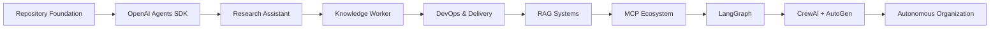
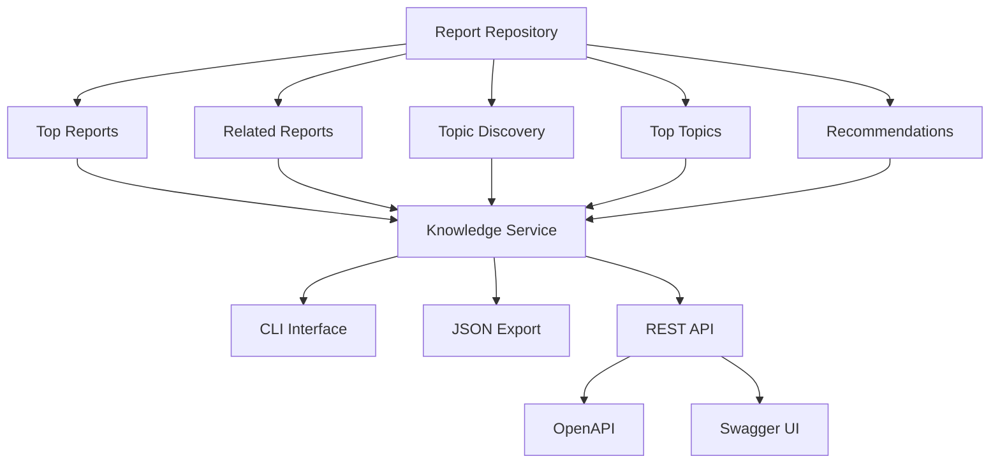
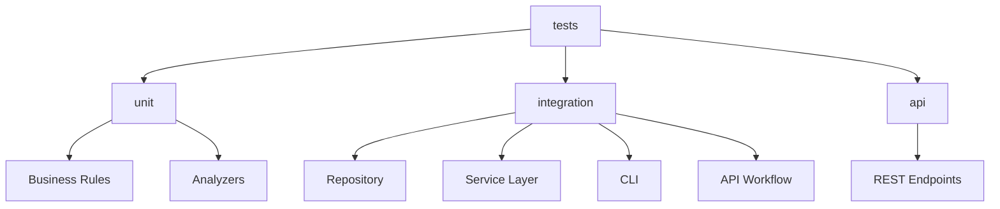
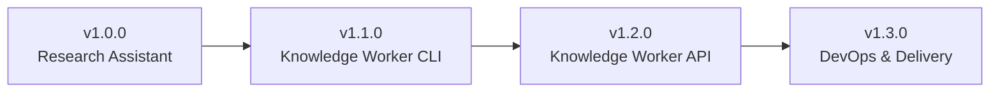
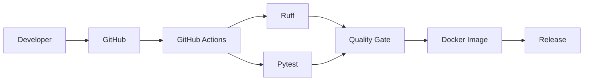
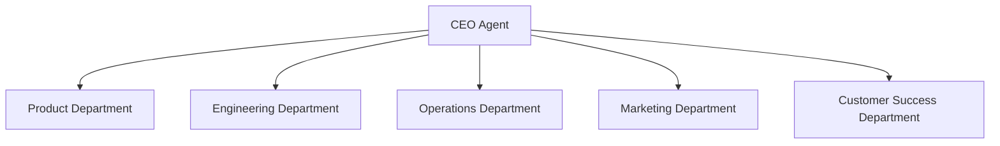

# 🗺️ Autonomous AI Agents Hub Roadmap

> Strategic execution plan for building production-ready autonomous AI systems.

---

# 🎯 Vision

The objective of this repository is to progressively evolve from simple AI agents to fully autonomous multi-agent organizations.

This repository serves as:

- A technical learning journey
- An engineering portfolio
- A production experimentation platform
- A reference architecture hub

---

# 📚 Table of Contents

- [🎯 Vision](#-vision)
- [📈 Program Progress](#-program-progress)
- [🧭 Learning Path](#-learning-path)
- [🚀 Portfolio Roadmap](#-portfolio-roadmap)
- [✅ Completed Projects](#-completed-projects)
- [🗺️ Milestones](#️-milestones)
- [✅ Completed Milestones](#-completed-milestones)
- [🚧 Active Development](#-active-development)
- [🔮 Future Roadmap](#-future-roadmap)
- [📍 Current Focus](#-current-focus)
- [🎯 Long-Term Targets](#-long-term-targets)
- [🚀 North Star](#-north-star)

---

# 📈 Program Progress

| Domain | Progress |
|:---|:---:|
| Repository Foundation | 🟩🟩🟩🟩🟩🟩🟩🟩🟩🟩 100% |
| OpenAI Agents SDK | 🟩🟩🟩🟩🟩🟩🟩🟩🟩🟩 100% |
| Research Assistant | 🟩🟩🟩🟩🟩🟩🟩🟩🟩🟩 100% |
| Knowledge Worker | 🟩🟩🟩🟩🟩🟩🟩🟩🟩🟩 100% |
| REST API Engineering | 🟩🟩🟩🟩🟩🟩🟩🟩🟩🟩 100% |
| DevOps & Delivery | 🟩⬜⬜⬜⬜⬜⬜⬜⬜⬜ 10% |
| RAG Systems | ⬜⬜⬜⬜⬜⬜⬜⬜⬜⬜ 0% |
| MCP Integration | ⬜⬜⬜⬜⬜⬜⬜⬜⬜⬜ 0% |
| LangGraph | ⬜⬜⬜⬜⬜⬜⬜⬜⬜⬜ 0% |
| CrewAI | ⬜⬜⬜⬜⬜⬜⬜⬜⬜⬜ 0% |
| AutoGen | ⬜⬜⬜⬜⬜⬜⬜⬜⬜⬜ 0% |

---

# 🧭 Learning Path



---

# 🚀 Portfolio Roadmap

| # | Project | Objective | Core Technologies | Status |
|:---:|:---|:---|:---|:---:|
| 01 | Research Assistant | Multi-agent research platform | OpenAI Agents SDK | ✅ |
| 02 | Knowledge Worker | Knowledge exploitation layer | Analytics, FastAPI | ✅ |
| 03 | DevOps Foundation | Delivery & deployment workflows | Docker, GitHub Actions | 🚧 |
| 04 | RAG Systems | Retrieval-Augmented Generation | Embeddings, ChromaDB | ⏳ |
| 05 | MCP Developer Assistant | Tool-enabled engineering copilot | MCP, GitHub | ⏳ |
| 06 | Code Review Agent | Automated code quality analysis | OpenAI Agents SDK | ⏳ |
| 07 | Customer Support Agent | Enterprise support platform | RAG, MCP | ⏳ |
| 08 | Content Factory | Autonomous content production | CrewAI | ⏳ |
| 09 | Recruiting Agent | Candidate analysis pipeline | Embeddings, Classification | ⏳ |
| 10 | Autonomous Team | Collaborative AI workforce | LangGraph | ⏳ |
| 11 | Software Engineering Team | Autonomous software delivery | AutoGen | ⏳ |
| 12 | Autonomous Organization | End-to-end agent ecosystem | Combined Technologies | ⏳ |

---

# ✅ Completed Projects

## Knowledge Worker

**Status:** ✅ COMPLETED (v1.2.1)

### Objective

Transform archived reports into reusable organizational knowledge through automated analysis, topic discovery, recommendations and report relationship detection.

### Delivered Capabilities

| Capability | Status |
|:---|:---:|
| Top Reports | ✅ |
| Related Reports | ✅ |
| Topic Discovery | ✅ |
| Top Topics | ✅ |
| Recommendations | ✅ |
| JSON Export | ✅ |
| CLI Interface | ✅ |
| FastAPI REST API | ✅ |
| OpenAPI Documentation | ✅ |
| Swagger UI | ✅ |

### REST API Endpoints

```text
GET /health
GET /topics
GET /top-topics
GET /recommendations
GET /top-reports
GET /related/{topic}
```

### Architecture



### Quality Metrics

```text
Tests Passed: 70
Coverage: 92%

CI:
✅ GitHub Actions

Containerization:
✅ Docker Support

Lint Status:
✅ Ruff Passing

Architecture:
✅ Layered Architecture
✅ Repository Pattern
✅ Service Layer
✅ REST API Layer

Testing:
✅ Unit Tests
✅ Integration Tests
✅ API Tests
✅ End-to-End API Workflow

Quality:
✅ Type Hints
✅ Pydantic Models
✅ OpenAPI Documentation
✅ Swagger UI
```

### Next Evolution

```text
DevOps & Delivery Foundation
```

---

# 🗺️ Milestones

| Milestone | Objective | Status |
|:---|:---|:---:|
| M1 | Repository Foundation | ✅ |
| M2 | OpenAI Agents SDK Mastery | ✅ |
| M3 | Research Assistant v1.0 | ✅ |
| M4 | Knowledge Worker Foundations | ✅ |
| M5 | Knowledge Worker API Platform | ✅ |
| M6 | DevOps & Delivery Foundation | 🚧 |
| M7 | RAG Systems | ⏳ |
| M8 | MCP Ecosystem | ⏳ |
| M9 | Multi-Agent Architectures | ⏳ |
| M10 | Production AI Platforms | ⏳ |
| M11 | Autonomous Organizations | ⏳ |


# ✅ Completed Milestones

## Sprint 01 — Repository Foundation

### Status

✅ COMPLETED

### Deliverables

- Repository structure
- Engineering standards
- Documentation suite
- GitHub setup
- CI foundation
- Environment configuration

### Outcome

A scalable engineering foundation was established for long-term AI portfolio development.

---

## Sprint 02 — OpenAI Agents SDK Fundamentals

### Status

✅ COMPLETED

### Deliverables

- Hello Agent
- Tool Calling
- Structured Outputs
- Evaluation Workflows
- Pydantic Models
- Function Tools
- Automated Validation

### Releases

| Version | Release |
|:---:|:---|
| v0.1.0 | Repository Foundation |
| v0.2.0 | Hello Agent |
| v0.3.0 | Tool Calling |
| v0.4.0 | Structured Outputs |
| v0.5.0 | Evaluation |

### Outcome

Core OpenAI Agents SDK concepts mastered and validated.

---

## Sprint 03 — Research Assistant Foundations

### Status

✅ COMPLETED

### Deliverables

- Coordinator Agent
- Search Agent
- Summarizer Agent
- Fact Checker Agent
- Structured Outputs
- Multi-Agent Workflow
- End-to-End Research Pipeline

### Outcome

First production-oriented multi-agent system successfully implemented.

---

## Sprint 04 — Production Readiness

### Status

✅ COMPLETED

### Deliverables

- Execution Logging
- Workflow Metrics
- Markdown Export
- CLI Interface
- Evaluation Framework
- Enhanced Testing

### Outcome

Research Assistant evolved from prototype to production-grade project.

---

## Sprint 05 — Research Assistant v1.0

### Status

✅ COMPLETED

### Deliverables

- Report Repository
- Report Metadata
- History CLI
- Latest CLI
- Show CLI
- Search CLI
- Compare CLI
- Statistics CLI
- Real Report Filtering
- Archive Management

### Quality Metrics

```text
27 Passing Tests
Ruff Validation
GitHub Versioned
Documentation Updated
Production Ready
```

### Release

```text
v1.0.0
```

### Outcome

Research Assistant v1.0 officially completed.

---

## Sprint 06 — Knowledge Worker Foundations

### Status

✅ COMPLETED

### Deliverables

- Repository Layer
- Service Layer
- Topic Discovery
- Top Topics
- Recommendations
- Related Reports
- CLI Interface
- JSON Export

### Release

```text
v1.1.0
```

### Quality Metrics

```text
62 Passing Tests
Ruff Passing
Production Ready
```

### Outcome

Archived reports successfully transformed into reusable organizational knowledge through analytical services and command-line tooling.

---

## Sprint 07 — Knowledge Worker API Platform

### Status

✅ COMPLETED

### Deliverables

#### Core API

- FastAPI Integration
- REST API
- OpenAPI Documentation
- Swagger UI
- Pydantic Response Models

#### REST Endpoints

```text
GET /health
GET /topics
GET /top-topics
GET /recommendations
GET /top-reports
GET /related/{topic}
```

#### Testing Architecture

- Unit Tests
- Integration Tests
- API Tests
- End-to-End API Workflow

#### Engineering Improvements

- Layered Test Architecture
- OpenAPI Schemas
- Swagger Documentation
- Typed Responses
- Modular Test Organization

### Test Architecture



### Quality Metrics

```text
70 Passing Tests

Ruff Passing

Architecture
✅ Layered Architecture
✅ Repository Pattern
✅ Service Layer
✅ REST API Layer

Testing
✅ Unit Tests
✅ Integration Tests
✅ API Tests
✅ End-to-End API Workflow

Documentation
✅ OpenAPI
✅ Swagger UI

Quality
✅ Type Hints
✅ Pydantic Models
✅ API Documentation
```

### Release

```text
v1.2.0
```

### Outcome

Knowledge Worker evolved from a command-line analytics tool into a fully documented REST API platform with layered testing architecture and production-ready engineering standards.

---


## 📦 Release Notes — v1.2.0

### Release Date

```text
November 2026
```

### Summary

Knowledge Worker evolved from a command-line analytics tool into a fully documented REST API platform featuring OpenAPI documentation, Swagger UI, structured response models and a layered testing strategy.

### Major Features

#### REST API

```text
GET /health
GET /topics
GET /top-topics
GET /recommendations
GET /top-reports
GET /related/{topic}
```

#### API Documentation

```text
✅ OpenAPI Specification
✅ Swagger UI
✅ Endpoint Descriptions
✅ Response Models
✅ Interactive Documentation
```

#### Pydantic Models

```text
✅ HealthResponse
✅ RecommendationResponse
✅ TopicCount
✅ Typed API Responses
```

#### Testing Architecture

```text
tests/
├── api/
├── integration/
└── unit/
```

### Quality Improvements

```text
✅ 70 Passing Tests

✅ Unit Tests
✅ Integration Tests
✅ API Tests
✅ End-to-End API Workflow

✅ Ruff Validation

✅ Layered Test Architecture
✅ Repository Pattern
✅ Service Layer
✅ REST API Layer
```

### Repository Evolution



### Impact

The project now provides:

- Command-Line Interface
- JSON Export Support
- REST API Access
- OpenAPI Documentation
- Swagger UI
- Layered Testing Strategy

This release establishes the foundation required for containerization, CI/CD pipelines, deployment automation and future AI platform development.

### Migration Path

```text
v1.0.0
    ↓
Research Assistant

v1.1.0
    ↓
Knowledge Worker CLI

v1.2.0
    ↓
Knowledge Worker API Platform

v1.3.0
    ↓
DevOps & Delivery Foundation
```


---

# 🚧 Active Development

## Sprint 08 — DevOps & Delivery Foundation

### Status

🚧 IN PROGRESS

### Objective

Transform the repository into a deployable and continuously validated engineering platform.

### Architecture Target



### Planned Deliverables

- Docker Support
- Docker Compose
- GitHub Actions CI
- Automated Test Pipeline
- Ruff Validation Pipeline
- Release Automation
- Developer Onboarding Improvements

### Definition of Done

```text
✅ Containerized Application

✅ Continuous Integration

✅ Automated Quality Gates

✅ One-Command Environment Setup

✅ Automated Release Workflow
```

---

# 🔮 Future Roadmap

## Sprint 09 — RAG Systems

### Goals

- Embeddings
- Semantic Search
- ChromaDB
- Vector Storage
- Retrieval Pipelines

### Definition of Done

✅ End-to-End RAG Pipeline

✅ Grounded Responses

---

## Sprint 10 — MCP Fundamentals

### Goals

- MCP Concepts
- Filesystem MCP
- GitHub MCP
- Tool Exposure
- MCP Workflows

### Definition of Done

✅ First MCP-enabled Agent

---

## Sprint 11 — MCP Developer Assistant

### Goals

- Repository Navigation
- Documentation Search
- Local File Access
- GitHub Integration
- Engineering Copilot

### Definition of Done

✅ Tool-enabled Developer Assistant

---

## Sprint 12 — LangGraph Fundamentals

### Goals

- State Management
- Conditional Routing
- Persistence
- Human-in-the-Loop

### Definition of Done

✅ Stateful Workflow Architecture

---

## Sprint 13 — Autonomous Team

### Goals

- Multi-Agent Collaboration
- Shared Context
- Delegation
- Planning

### Definition of Done

✅ Collaborative AI Workforce

---

## Sprint 14 — CrewAI Foundations

### Goals

- Crew Creation
- Role-Based Agents
- Process Flows
- Collaboration

### Definition of Done

✅ Functional Crew Architecture

---

## Sprint 15 — Content Factory

### Goals

- Research Automation
- Content Creation
- Editing
- SEO Optimization

### Definition of Done

✅ Autonomous Content Pipeline

---

## Sprint 16 — AutoGen Foundations

### Goals

- Agent Conversations
- Negotiation
- Planning
- Autonomous Collaboration

### Definition of Done

✅ Autonomous Multi-Agent Discussions

---

## Sprint 17 — Software Engineering Team

### Goals

- Architecture
- Development
- QA
- Code Review
- Delivery

### Definition of Done

✅ Autonomous Software Workflow

---

## Sprint 18 — Production Engineering

### Goals

- Observability
- Monitoring
- Security
- Cost Optimization
- Platform Hardening

### Definition of Done

✅ Production-Grade AI Platform

---

## Sprint 19 — Autonomous Organization

### Final Vision



### Success Criteria

✅ Strategic Planning

✅ Agent Delegation

✅ Collaborative Execution

✅ Human Oversight

✅ Production Reliability

---

# 📍 Current Focus

| Priority | Initiative | Status |
|:---:|:---|:---:|
| 1 | DevOps & Delivery Foundation | 🚧 |
| 2 | RAG Systems | ⏳ |
| 3 | MCP Ecosystem | ⏳ |
| 4 | LangGraph Workflows | ⏳ |
| 5 | Multi-Agent Architectures | ⏳ |

---

## Recently Completed

| Initiative | Status |
|:---|:---:|
| Knowledge Worker API Platform | ✅ |
| Layered Testing Architecture | ✅ |
| FastAPI Integration | ✅ |
| OpenAPI Documentation | ✅ |
| Swagger UI | ✅ |
| REST API Endpoints | ✅ |

### Latest Release Metrics

```text
Version: v1.2.0

Tests: 70 Passed

Lint: Ruff Passing

Knowledge Worker: Complete

REST API: Complete

OpenAPI: Complete

Swagger: Complete

Testing Architecture:
- Unit
- Integration
- API

Status: Production Ready
```

---

# 🎯 Long-Term Targets

| Metric | Goal |
|:---|:---|
| Production Projects | 10+ |
| Agent Frameworks Mastered | 5+ |
| MCP Integrations | 5+ |
| Multi-Agent Systems | 5+ |
| RAG Implementations | 3+ |
| End-to-End Architectures | 10+ |
| Portfolio Quality | Production Grade |

---

# 🚀 North Star

> **Build one of the most complete public repositories dedicated to Agentic AI Engineering, progressing from individual agents to fully autonomous organizations.**
# ✅ Completed Milestones

## Sprint 01 — Repository Foundation

### Status

✅ COMPLETED

### Deliverables

- Repository structure
- Engineering standards
- Documentation suite
- GitHub setup
- CI foundation
- Environment configuration

---

## Sprint 06 — Knowledge Worker Foundations

### Status

✅ COMPLETED

### Deliverables

- Repository Layer
- Service Layer
- Topic Discovery
- Top Topics
- Recommendations
- Related Reports
- CLI Interface
- JSON Export

### Quality Metrics

```text
62 Tests Passed
Ruff Passing
Production Ready
```

---

## Sprint 07 — Knowledge Worker API

### Status

✅ COMPLETED

### Deliverables

- FastAPI Integration
- REST API
- OpenAPI Documentation
- Swagger UI
- Pydantic Response Models

### Endpoints

```text
GET /health
GET /topics
GET /top-topics
GET /recommendations
GET /top-reports
GET /related/{topic}
```

### Testing

```text
Unit Tests
Integration Tests
API Tests
End-to-End API Workflow
```

### Quality Metrics

```text
70 Tests Passed
Ruff Passing
Layered Test Architecture
```

### Outcome

The repository foundation is fully established and ready for long-term development.

---

## Sprint 02 — OpenAI Agents SDK Fundamentals

### Status

✅ COMPLETED

### Deliverables

- Hello Agent
- Tool Calling
- Structured Outputs
- Evaluation Workflows
- Pydantic Models
- Function Tools
- Automated Validation

### Releases

| Version | Release |
|:---:|:---|
| v0.1.0 | Repository Foundation |
| v0.2.0 | Hello Agent |
| v0.3.0 | Tool Calling |
| v0.4.0 | Structured Outputs |
| v0.5.0 | Evaluation |

### Outcome

Core OpenAI Agents SDK concepts mastered and validated.

---

## Sprint 03 — Research Assistant Foundations

### Status

✅ COMPLETED

### Deliverables

- Coordinator Agent
- Search Agent
- Summarizer Agent
- Fact Checker Agent
- Structured Outputs
- Multi-Agent Workflow
- End-to-End Research Pipeline

### Outcome

First production-oriented multi-agent system successfully implemented.

---

## Sprint 04 — Production Readiness

### Status

✅ COMPLETED

### Deliverables

- Execution Logging
- Workflow Metrics
- Markdown Export
- CLI Interface
- Evaluation Framework
- Enhanced Testing

### Outcome

Research Assistant evolved from prototype to production-grade project.

---

## Sprint 05 — Research Assistant v1.0

### Status

✅ COMPLETED

### Deliverables

- Report Repository
- Report Metadata
- History CLI
- Latest CLI
- Show CLI
- Search CLI
- Compare CLI
- Statistics CLI
- Real Report Filtering
- Archive Management

### Quality Metrics

```text
✅ 27 Passing Tests

✅ Ruff Validation

✅ GitHub Versioned

✅ Documentation Updated

✅ Production Ready
```

### Release

```text
v1.0.0
```

### Outcome

Research Assistant v1.0 officially completed.

# ✅ Completed Project

## Knowledge Worker

### Status

✅ COMPLETED (v1.1.0)

### Objective

Transform archived reports into reusable organizational knowledge through automated analysis, topic discovery, recommendations, and report relationship detection.

### Delivered Capabilities

| Capability | Status |
|:---|:---:|
| Top Reports | ✅ |
| Related Reports | ✅ |
| Topic Discovery | ✅ |
| Top Topics | ✅ |
| Recommendations | ✅ |
| JSON Export | ✅ |
| CLI Interface | ✅ |

### Implemented Commands

```bash
python -m app.main --top-reports

python -m app.main --topics

python -m app.main --top-topics

python -m app.main --recommendations

python -m app.main --recommendations 5

python -m app.main --related "Fusion Energy"
```

### JSON Export Support

```bash
python -m app.main --top-reports --json

python -m app.main --topics --json

python -m app.main --top-topics --json

python -m app.main --recommendations --json

python -m app.main --related "Fusion Energy" --json
```

### Final Architecture

```text
Report Repository
        ↓

Analyzers
├── Top Reports
├── Related Reports
├── Topic Discovery
├── Top Topics
└── Recommendations

        ↓

Knowledge Service
        ↓

CLI Interface
        ↓

JSON Export
```

### Quality Metrics

```text
Tests Passed: 62
Lint Status: Ruff Passing
Architecture: Layered
Type Hints: Enabled
JSON Support: Complete
CLI Coverage: Complete
```

### Future Enhancements

```text
FastAPI REST API
CSV Export
OpenAPI Documentation
Knowledge Graph Visualization
Semantic Search
Embeddings
Vector Database Integration
```

# 🚧 Active Development

No active sprint currently.

### Next Planned Initiative

Sprint 07 — Knowledge Worker API

#### Goal

Expose Knowledge Worker capabilities through a FastAPI-powered REST API.

#### Planned Endpoints

```text
GET /topics

GET /top-topics

GET /recommendations

GET /top-reports

GET /related/{topic}
```

# 🔮 Future Roadmap

## Sprint 07 — RAG Systems

### Goals

- Embeddings
- Semantic Search
- ChromaDB
- Vector Storage
- Retrieval Pipelines

### Definition of Done

✅ End-to-End RAG Pipeline

✅ Grounded Responses

---

## Sprint 08 — MCP Fundamentals

### Goals

- MCP Concepts
- Filesystem MCP
- GitHub MCP
- Tool Exposure
- MCP Workflows

### Definition of Done

✅ First MCP-enabled Agent

---

## Sprint 09 — MCP Developer Assistant

### Goals

- Repository Navigation
- Documentation Search
- Local File Access
- GitHub Integration
- Engineering Copilot

### Definition of Done

✅ Tool-enabled Developer Assistant

---

## Sprint 10 — LangGraph Fundamentals

### Goals

- State Management
- Conditional Routing
- Persistence
- Human-in-the-Loop

### Definition of Done

✅ Stateful Workflow Architecture

---

## Sprint 11 — Autonomous Team

### Goals

- Multi-Agent Collaboration
- Shared Context
- Delegation
- Planning

### Definition of Done

✅ Collaborative AI Workforce

---

## Sprint 12 — CrewAI Foundations

### Goals

- Crew Creation
- Role-Based Agents
- Process Flows
- Collaboration

### Definition of Done

✅ Functional Crew Architecture

---

## Sprint 13 — Content Factory

### Goals

- Research Automation
- Content Creation
- Editing
- SEO Optimization

### Definition of Done

✅ Autonomous Content Pipeline

---

## Sprint 14 — AutoGen Foundations

### Goals

- Agent Conversations
- Negotiation
- Planning
- Autonomous Collaboration

### Definition of Done

✅ Autonomous Multi-Agent Discussions

---

## Sprint 15 — Software Engineering Team

### Goals

- Architecture
- Development
- QA
- Code Review
- Delivery

### Definition of Done

✅ Autonomous Software Workflow

---

## Sprint 16 — Production Engineering

### Goals

- Observability
- Monitoring
- Security
- Cost Optimization
- Platform Hardening

### Definition of Done

✅ Production-Grade AI Platform

---

## Sprint 17 — Autonomous Organization

### Final Vision

```text
CEO Agent
│
├── Product Department
├── Engineering Department
├── Operations Department
├── Marketing Department
└── Customer Success Department
```

### Success Criteria

✅ Strategic Planning

✅ Agent Delegation

✅ Collaborative Execution

✅ Human Oversight

✅ Production Reliability

# 📍 Current Focus

| Priority | Initiative | Status |
|:---:|:---|:---:|
| 1 | Knowledge Worker API (FastAPI) | 🚧 |
| 2 | RAG Systems Foundations | ⏳ |
| 3 | MCP Integration | ⏳ |
| 4 | LangGraph Workflows | ⏳ |
| 5 | Multi-Agent Orchestration | ⏳ |

---

## Recently Completed

| Initiative | Status |
|:---|:---:|
| Knowledge Worker Foundations | ✅ |
| Top Reports | ✅ |
| Related Reports | ✅ |
| Topic Discovery | ✅ |
| Top Topics | ✅ |
| Recommendations | ✅ |
| JSON Export | ✅ |

### Knowledge Worker Completion Metrics

```text
Version: v1.1.0
Tests: 62 Passed
Lint: Ruff Passing
CLI: Complete
JSON Export: Complete
Status: Production Ready
```

---


# 🎯 Long-Term Targets

| Metric | Goal |
|:---|:---|
| Production Projects | 10+ |
| Agent Frameworks Mastered | 5+ |
| MCP Integrations | 5+ |
| Multi-Agent Systems | 5+ |
| RAG Implementations | 3+ |
| End-to-End Architectures | 10+ |
| Portfolio Quality | Production Grade |

---

# 🚀 North Star

**Build one of the most complete public repositories dedicated to Agentic AI Engineering, progressing from individual agents to fully autonomous organizations.**