# 🗺️ Autonomous AI Agents Hub Roadmap

> Strategic execution plan for building production-grade AI systems, progressing from individual agents to fully autonomous organizations.

---

# 🎯 Vision

The objective of this repository is to progressively evolve from simple AI agents to fully autonomous multi-agent organizations.

This repository serves as:

- A technical learning journey
- An engineering portfolio
- A production experimentation platform
- A reference architecture hub

---

# 📚 Table of Contents

- Vision
- Program Progress
- Learning Path
- Portfolio Roadmap
- Delivered Projects
- Milestones
- Completed Milestones
- Current Development Track
- Strategic Roadmap
- Current Focus
- Long-Term Targets
- North Star

---

# 📈 Program Progress

| Domain | Progress |
|:---|:---:|
| Repository Foundation | 🟩🟩🟩🟩🟩🟩🟩🟩🟩🟩 100% |
| OpenAI Agents SDK | 🟩🟩🟩🟩🟩🟩🟩🟩🟩🟩 100% |
| Research Assistant | 🟩🟩🟩🟩🟩🟩🟩🟩🟩🟩 100% |
| Knowledge Worker | 🟩🟩🟩🟩🟩🟩🟩🟩🟩🟩 100% |
| REST API Engineering | 🟩🟩🟩🟩🟩🟩🟩🟩🟩🟩 100% |
| DevOps & Delivery | 🟩🟩🟩🟩🟩🟩🟩🟩🟩🟩 100% |
| RAG Systems | 🟩🟩🟩🟩🟩🟩🟩🟩🟩🟩 100% |
| MCP Ecosystem | 🟩⬜⬜⬜⬜⬜⬜⬜⬜⬜ 10% |
| LangGraph | ⬜⬜⬜⬜⬜⬜⬜⬜⬜⬜ 0% |
| CrewAI | ⬜⬜⬜⬜⬜⬜⬜⬜⬜⬜ 0% |
| AutoGen | ⬜⬜⬜⬜⬜⬜⬜⬜⬜⬜ 0% |

---

# 🧭 Learning Path

```mermaid
flowchart LR

A[Repository Foundation]
--> B[OpenAI Agents SDK]

B --> C[Research Assistant]

C --> D[Knowledge Worker]

D --> E[DevOps & Delivery]

E --> F[RAG Assistant]

F --> G[MCP Ecosystem]

G --> H[LangGraph]

H --> I[CrewAI + AutoGen]

I --> J[Autonomous Organization]
```



---

# 🚀 Portfolio Roadmap

| # | Project | Objective | Status |
|:---:|:---|:---|:---:|
| 01 | Research Assistant | Multi-Agent Research Platform | ✅ |
| 02 | Knowledge Worker | Knowledge Exploitation Platform | ✅ |
| 03 | DevOps Foundation | CI/CD & Delivery Automation | ✅ |
| 04 | RAG Assistant | Semantic Retrieval Platform | ✅ |
| 05 | MCP Developer Assistant | Tool-Augmented Engineering Copilot | 🚧 |
| 06 | Code Review Agent | Automated Code Quality Platform | ⏳ |
| 07 | Customer Support Agent | RAG + MCP Support Platform | ⏳ |
| 08 | Content Factory | Autonomous Content Production | ⏳ |
| 09 | Recruiting Agent | Candidate Intelligence Platform | ⏳ |
| 10 | Autonomous Team | Multi-Agent Collaboration Platform | ⏳ |
| 11 | Software Engineering Team | Autonomous Software Delivery | ⏳ |
| 12 | Autonomous Organization | End-to-End Agent Ecosystem | ⏳ |

---

# ✅ Delivered Projects

## Research Assistant

**Status:** Released

### Key Deliverables

- Coordinator Agent
- Search Agent
- Summarizer Agent
- Fact Checker Agent
- Multi-Agent Workflow
- Evaluation Framework
- Markdown Reporting

---

## Knowledge Worker

**Status:** Released (v1.3.0)

### Key Deliverables

- Topic Discovery
- Top Topics
- Recommendations
- Related Reports
- JSON Export
- FastAPI REST API
- OpenAPI Documentation
- Swagger UI
- Docker Support
- GitHub Actions CI

### Quality

```text
70 Tests
92% Coverage
Ruff
Docker
CI/CD
```

---

## RAG Assistant

**Status:** Released (v3.0.0)

### Key Deliverables

- OpenAI Embeddings
- Cached Embeddings
- Embedded Documents
- Semantic Vector Store
- Cosine Similarity Search
- Semantic Retrieval
- Semantic RAG Pipeline
- End-to-End Retrieval Workflow

### Quality

```text
34 Tests
100% Coverage
Ruff
MyPy
Semantic Retrieval
Semantic RAG
```

---

# 🗺️ Milestones

| Milestone | Objective | Status |
|:---|:---|:---:|
| M1 | Repository Foundation | ✅ |
| M2 | OpenAI Agents SDK Mastery | ✅ |
| M3 | Research Assistant | ✅ |
| M4 | Knowledge Worker Foundations | ✅ |
| M5 | Knowledge Worker API Platform | ✅ |
| M6 | DevOps & Delivery Foundation | ✅ |
| M7 | RAG Systems | ✅ |
| M8 | MCP Ecosystem | 🚧 |
| M9 | Multi-Agent Architectures | ⏳ |
| M10 | Production AI Platforms | ⏳ |
| M11 | Autonomous Organizations | ⏳ |

---

# ✅ Completed Milestones

## Repository Foundation

Engineering standards, repository structure, documentation, tooling and automation foundations established.

✅ Completed

---

## OpenAI Agents SDK Mastery

Tool Calling, Structured Outputs, Function Tools, Evaluations and Validation workflows implemented.

✅ Completed

---

## Research Assistant

First production-oriented multi-agent application successfully delivered.

✅ Completed

---

## Knowledge Worker

Knowledge extraction and exploitation platform delivered with CLI, API and analytics capabilities.

✅ Completed

---

## DevOps Foundation

Docker, CI/CD, automated quality gates and project delivery workflows established.

✅ Completed

---

## Semantic RAG Systems

Semantic Retrieval-Augmented Generation platform successfully implemented.

✅ Completed

---

# 🚧 Current Development Track

## Sprint 09 — MCP Developer Assistant

### Objective

Build a tool-augmented engineering copilot using Model Context Protocol (MCP).

### Planned Deliverables

- Filesystem MCP
- GitHub MCP
- Repository Navigation
- Documentation Search
- Tool-Augmented Agent

### Definition of Done

```text
✅ MCP Integration
✅ Repository Awareness
✅ Documentation Navigation
✅ Engineering Assistant
```

---

# 🔮 Strategic Roadmap

## Sprint 10 — MCP Ecosystem

- MCP Concepts
- Filesystem MCP
- GitHub MCP
- Tool Exposure
- MCP Workflows

---

## Sprint 11 — LangGraph Foundations

- State Management
- Conditional Routing
- Persistence
- Human-in-the-Loop

---

## Sprint 12 — Autonomous Team

- Multi-Agent Coordination
- Task Delegation
- Shared Context
- Collaborative Execution

---

## Sprint 13 — CrewAI Foundations

- Crews
- Roles
- Collaboration Flows
- Process Automation

---

## Sprint 14 — Content Factory

- Research Automation
- Content Creation
- Editing
- SEO Optimization

---

## Sprint 15 — AutoGen Foundations

- Agent Conversations
- Negotiation
- Planning
- Autonomous Collaboration

---

## Sprint 16 — Software Engineering Team

- Architecture
- Development
- QA
- Code Review
- Delivery

---

## Sprint 17 — Production Engineering

- Observability
- Monitoring
- Security
- Cost Optimization
- Platform Hardening

---

## Sprint 18 — Autonomous Organization

- Department Agents
- Cross-Agent Coordination
- Strategic Planning
- Human Oversight

---

# 📍 Current Focus

| Priority | Initiative | Status |
|:---:|:---|:---:|
| 1 | MCP Developer Assistant | 🚧 |
| 2 | MCP Ecosystem | ⏳ |
| 3 | LangGraph | ⏳ |
| 4 | Multi-Agent Architectures | ⏳ |
| 5 | Autonomous Organizations | ⏳ |

---

# 🎯 Long-Term Targets

| Metric | Goal |
|:---|:---|
| Production Projects | 10+ |
| Agent Frameworks Mastered | 5+ |
| MCP Integrations | 5+ |
| Multi-Agent Systems | 5+ |
| RAG Implementations | 3+ |
| End-to-End Architectures | 10+ |
| Portfolio Quality | Production Grade |

---

# 🚀 North Star

> Build one of the most complete public repositories dedicated to Agentic AI Engineering, progressively evolving from individual AI agents to fully autonomous organizations.