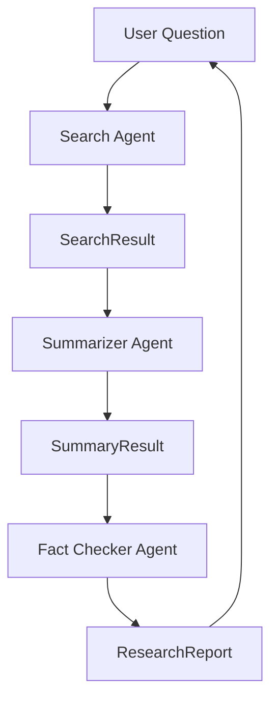

# 🔍 Research Assistant

Multi-agent research system built with OpenAI Agents SDK.

## Status

✅ Sprint 03 Completed

**Current Sprint:** 04

**Current Phase:** Production Readiness

---

## Objective

The Research Assistant is the first production-oriented project in the Autonomous AI Agents Hub roadmap.

Its purpose is to transform a user question into a structured and verifiable research report by orchestrating multiple specialized AI agents.

---

## Business Goals

- Collect information from multiple sources
- Synthesize findings into concise insights
- Validate information quality
- Produce structured research reports
- Establish reusable multi-agent patterns

---

## Current Architecture



---

## Agent Responsibilities

### Coordinator Agent

Responsible for workflow orchestration.

Responsibilities:

- Coordinate workflow execution
- Manage agent interactions
- Supervise report generation

Status:

```text
✅ Implemented
```

---

### Search Agent

Responsible for information gathering.

Responsibilities:

- Analyze research topics
- Collect findings
- Produce SearchResult outputs

Output:

```text
SearchResult
```

Status:

```text
✅ Implemented
✅ Structured Output
✅ Real OpenAI Execution
```

---

### Summarizer Agent

Responsible for information synthesis.

Responsibilities:

- Analyze search findings
- Extract key insights
- Produce structured summaries

Output:

```text
SummaryResult
```

Status:

```text
✅ Implemented
✅ Structured Output
✅ Real OpenAI Execution
```

---

### Fact Checker Agent

Responsible for quality validation.

Responsibilities:

- Review findings
- Detect inconsistencies
- Validate report accuracy
- Produce final report

Output:

```text
ResearchReport
```

Status:

```text
✅ Implemented
✅ Structured Output
✅ Real OpenAI Execution
```

---

## Data Contracts

### SearchResult

```text
topic
findings
source_count
```

---

### SummaryResult

```text
summary
key_points
confidence_score
```

---

### ResearchReport

```text
topic
executive_summary
key_findings
sources_reviewed
fact_check_notes
final_conclusion
```

---

## Workflow Engine

Current workflow:

```text
Question
    ↓
Search Agent
    ↓
SearchResult

    ↓

Summarizer Agent
    ↓
SummaryResult

    ↓

Fact Checker Agent
    ↓
ResearchReport
```

Capabilities:

```text
✅ Structured Outputs

✅ Agent Handoffs

✅ Serialization Layer

✅ Workflow Orchestration

✅ Retry Logic

✅ Timeout Handling

✅ Exponential Backoff

✅ End-to-End Execution
```

---

## Serialization Layer

The workflow uses dedicated serializers to transform agent outputs into prompts for downstream agents.

```text
SearchResult
    ↓
Serializer
    ↓
Summarizer Agent
```

```text
SummaryResult
    ↓
Serializer
    ↓
Fact Checker Agent
```

Benefits:

- Separation of concerns
- Reusable formatting logic
- Easier testing
- Cleaner workflows

---

## Expected Output

A structured research report.

Example:

```text
Research Report

Topic:
Quantum Computing

Executive Summary:
...

Key Findings:
1. ...
2. ...
3. ...

Sources Reviewed:
...

Fact Check Notes:
...

Final Conclusion:
...
```

---

## Project Structure

```text
research-assistant/
│
├── README.md
├── ROADMAP.md
├── requirements.txt
├── pytest.ini
├── .env.example
│
├── app/
│   ├── __init__.py
│   │
│   ├── agents/
│   │   ├── coordinator.py
│   │   ├── search.py
│   │   ├── summarizer.py
│   │   └── fact_checker.py
│   │
│   ├── serializers/
│   │   └── research.py
│   │
│   ├── models.py
│   ├── workflow.py
│   ├── config.py
│   │
│   ├── playground.py
│   ├── playground_summary.py
│   └── playground_workflow.py
│
└── tests/
    ├── test_agents.py
    ├── test_models.py
    ├── test_serializers.py
    └── test_workflow.py
```

---

## Development Progress

### Sprint 03.1 — Foundation

```text
✅ ResearchReport Model

✅ Coordinator Agent

✅ Search Agent

✅ Basic Workflow
```

---

### Sprint 03.2 — Research Processing

```text
✅ Summarizer Agent

✅ Structured Outputs

✅ Report Generation
```

---

### Sprint 03.3 — Quality Layer

```text
✅ Fact Checker Agent

✅ Validation Workflow

✅ Multi-Agent Orchestration

✅ Agent Handoffs
```

---

### Sprint 03.4 — Real Execution

```text
✅ OpenAI Agent Execution

✅ SearchResult

✅ SummaryResult

✅ ResearchReport

✅ Serialization Layer

✅ Workflow Engine

✅ Retry Logic

✅ Timeouts

✅ Exponential Backoff

✅ End-to-End Workflow
```

---

## Current Milestone

### Sprint 03 ✅ COMPLETED

Delivered:

```text
✅ Multi-Agent Research Workflow

✅ Structured Outputs

✅ Serialization Layer

✅ Retry Engine

✅ Timeout Management

✅ End-to-End Research Report Generation

✅ 15 Passing Tests

✅ Ruff Validation
```

---

## Validation Criteria

Completed:

```text
✅ Multi-agent workflow operational

✅ Structured reports generated

✅ Pytest passing

✅ Ruff validation passing

✅ End-to-End execution validated

✅ Documentation updated
```

---

## Run

### Full Workflow

```bash
python -m app.playground_workflow
```

---

### Search Agent

```bash
python -m app.playground
```

---

### Search → Summary Handoff

```bash
python -m app.playground_summary
```

---

## Run Tests

```bash
python -m pytest -v
```

Current Status:

```text
✅ 15 tests passing
```

---

## Quality Checks

```bash
python -m ruff check .
```

Current Status:

```text
✅ All checks passed
```

---

## Expected Learning Outcomes

This project introduces:

- Multi-agent orchestration
- Agent specialization
- Structured Outputs
- Agent collaboration
- Workflow coordination
- Research pipelines
- Serialization layers
- Retry strategies
- Timeout management
- Production-ready design patterns

---

## Next Evolution

Sprint 04 — Production Readiness

Planned work:

```text
Execution Logging
        ↓
Workflow Metrics
        ↓
Markdown Export
        ↓
CLI Interface
        ↓
Evaluation Framework
        ↓
Multi-Topic Research
```

---

## Roadmap Position

```text
Research Assistant
        ↓
Knowledge Worker
        ↓
Developer Assistant
        ↓
Multi-Agent Systems
        ↓
Autonomous Organization
```

The Research Assistant serves as the foundation for all future AI systems developed in this repository.