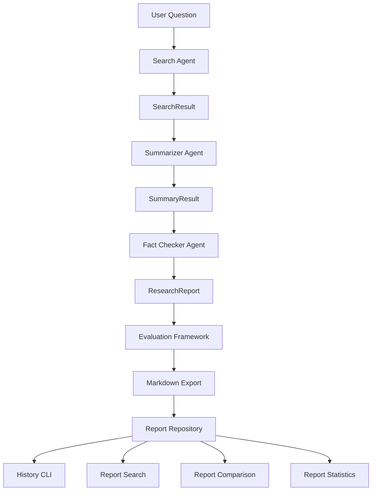

# 🔍 Research Assistant

Multi-agent research system built with the OpenAI Agents SDK.

---

# Status

✅ Sprint 03 Completed

✅ Sprint 04 Completed

✅ Sprint 05 Completed

**Current Version:** v1.0.0

**Current Phase:** Research Archive Management

---

# Objective

Research Assistant transforms a user question into a structured, validated, archived, searchable, and comparable research report through a multi-agent workflow.

The project serves as the first production-oriented implementation in the Autonomous AI Agents Hub roadmap.

---

# Business Goals

- Collect information from multiple sources
- Synthesize findings into concise insights
- Validate information quality
- Produce structured research reports
- Archive research outputs
- Search historical reports
- Compare report quality
- Analyze archive statistics
- Establish reusable multi-agent patterns

---

# Current Architecture



---

# Agent Responsibilities

## Coordinator Agent

Responsible for workflow orchestration.

Responsibilities:

- Coordinate workflow execution
- Manage agent interactions
- Supervise report generation

Status:

```text
✅ Implemented
```

---

## Search Agent

Responsible for information gathering.

Responsibilities:

- Analyze research topics
- Collect findings
- Produce SearchResult outputs

Output:

```text
SearchResult
```

Status:

```text
✅ Implemented
✅ Structured Output
✅ Real OpenAI Execution
```

---

## Summarizer Agent

Responsible for information synthesis.

Responsibilities:

- Analyze search findings
- Extract key insights
- Produce structured summaries

Output:

```text
SummaryResult
```

Status:

```text
✅ Implemented
✅ Structured Output
✅ Real OpenAI Execution
```

---

## Fact Checker Agent

Responsible for report validation.

Responsibilities:

- Review findings
- Detect inconsistencies
- Validate accuracy
- Produce final report

Output:

```text
ResearchReport
```

Status:

```text
✅ Implemented
✅ Structured Output
✅ Real OpenAI Execution
```

---

# Data Contracts

## SearchResult

```text
topic
findings
source_count
```

---

## SummaryResult

```text
summary
key_points
confidence_score
```

---

## ResearchReport

```text
topic
executive_summary
key_findings
sources_reviewed
fact_check_notes
final_conclusion
```

---

## ReportMetadata

```text
filename
topic
score
grade
```

---

# Workflow Engine

Current workflow:

```text
Question
    ↓
Search Agent
    ↓
SearchResult

    ↓

Summarizer Agent
    ↓
SummaryResult

    ↓

Fact Checker Agent
    ↓
ResearchReport

    ↓

Evaluation Framework
    ↓
Markdown Export
    ↓
Repository
```

Capabilities:

```text
✅ Structured Outputs

✅ Agent Handoffs

✅ Serialization Layer

✅ Workflow Orchestration

✅ Retry Logic

✅ Timeout Handling

✅ Exponential Backoff

✅ End-to-End Execution
```

---

# Evaluation Framework

The system automatically evaluates each generated report.

Metrics:

```text
Completeness Score
Content Score
Source Score
Overall Score
Grade
```

Grades:

```text
EXCELLENT
VERY GOOD
GOOD
FAIR
POOR
NEEDS IMPROVEMENT
```

---

# Report Management

The project includes a complete research archive layer.

Capabilities:

```text
✅ Report Repository

✅ Report History

✅ Report Retrieval

✅ Report Search

✅ Report Comparison

✅ Report Statistics

✅ Real Report Filtering
```

---

# CLI Commands

## Generate Research Report

```bash
python -m app.main "What is fusion energy?"
```

---

## Report History

```bash
python -m app.main --history
```

---

## Show Latest Report

```bash
python -m app.main --latest
```

---

## Show Report

```bash
python -m app.main --show <report>
```

Example:

```bash
python -m app.main --show report_2026-11-14_005630.md
```

---

## Search Reports

```bash
python -m app.main --search fusion
```

---

## Compare Reports

```bash
python -m app.main --compare report_a.md report_b.md
```

---

## Statistics

```bash
python -m app.main --stats
```

---

## Statistics (Real Reports Only)

```bash
python -m app.main --stats --real
```

---

# Example Report

```text
Research Report

Topic:
Quantum Computing

Executive Summary:
...

Key Findings:
1. ...
2. ...
3. ...

Sources Reviewed:
...

Fact Check Notes:
...

Final Conclusion:
...
```

---

# Project Structure

```text
research-assistant/
│
├── README.md
├── ROADMAP.md
├── requirements.txt
├── pytest.ini
├── .env.example
│
├── app/
│   │
│   ├── agents/
│   │   ├── coordinator.py
│   │   ├── search.py
│   │   ├── summarizer.py
│   │   └── fact_checker.py
│   │
│   ├── evaluators/
│   │   └── report_evaluator.py
│   │
│   ├── exporters/
│   │   └── markdown_exporter.py
│   │
│   ├── history/
│   │   └── report_repository.py
│   │
│   ├── logging/
│   │   └── execution_logger.py
│   │
│   ├── serializers/
│   │   └── research.py
│   │
│   ├── models.py
│   ├── workflow.py
│   ├── config.py
│   └── main.py
│
├── reports/
│
└── tests/
    ├── test_agents.py
    ├── test_evaluator.py
    ├── test_exporter.py
    ├── test_models.py
    ├── test_repository.py
    ├── test_serializers.py
    └── test_workflow.py
```

---

# Current Milestone

## Research Assistant v1.0 ✅ COMPLETED

Delivered:

```text
✅ Multi-Agent Research Workflow

✅ Structured Outputs

✅ Serialization Layer

✅ Retry Engine

✅ Timeout Management

✅ Logging

✅ Metrics

✅ Markdown Export

✅ Evaluation Framework

✅ Report Repository

✅ History CLI

✅ Latest CLI

✅ Show CLI

✅ Search CLI

✅ Compare CLI

✅ Statistics CLI

✅ Real Report Filtering

✅ 27 Passing Tests

✅ Ruff Validation
```

---

# Validation Criteria

Completed:

```text
✅ Multi-Agent Workflow Operational

✅ Structured Reports Generated

✅ Repository Operational

✅ Search Functional

✅ Report Comparison Functional

✅ Statistics Functional

✅ Pytest Passing

✅ Ruff Validation Passing

✅ End-to-End Execution Validated

✅ Documentation Updated
```

---

# Run Tests

```bash
python -m pytest -v
```

Current Status:

```text
✅ 27 tests passing
```

---

# Quality Checks

```bash
python -m ruff check .
```

Current Status:

```text
✅ All checks passed
```

---

# Expected Learning Outcomes

This project introduces:

- Multi-agent orchestration
- Agent specialization
- Structured Outputs
- Agent collaboration
- Workflow coordination
- Research pipelines
- Serialization layers
- Retry strategies
- Timeout management
- Evaluation frameworks
- Repository patterns
- Report indexing
- Search systems
- Comparison systems
- Statistics systems
- Production-ready design patterns

---

# Next Evolution

## Sprint 06 — Knowledge Worker Foundations

Planned capabilities:

```text
Top Reports
        ↓
Related Reports
        ↓
Recommendations
        ↓
Topic Discovery
        ↓
Knowledge Map
        ↓
Cross-Report Analysis
```

---

# Roadmap Position

```text
Research Assistant
        ↓
Knowledge Worker
        ↓
Developer Assistant
        ↓
Multi-Agent Systems
        ↓
Autonomous Organization
```

Research Assistant v1.0 serves as the foundation for all future AI systems developed in the Autonomous AI Agents Hub ecosystem.