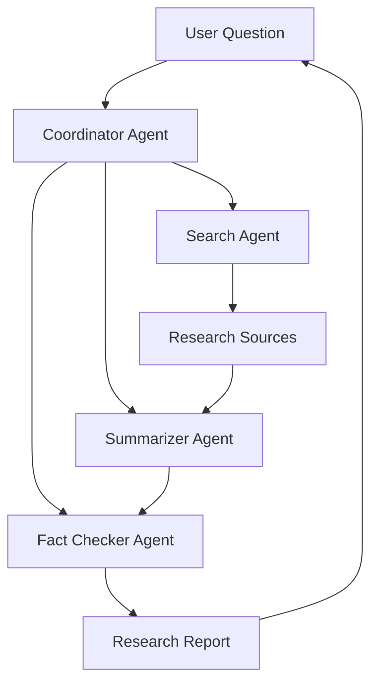

# 🔍 Research Assistant

Multi-agent research system built with OpenAI Agents SDK.

## Status

🚧 In Progress

**Sprint:** 03

---

## Objective

The Research Assistant is the first production-oriented project in the Autonomous AI Agents Hub roadmap.

Its purpose is to transform a user question into a structured and verifiable research report by orchestrating multiple specialized AI agents.

---

## Business Goals

- Collect information from multiple sources
- Synthesize findings into concise insights
- Validate information quality
- Produce structured research reports
- Establish reusable multi-agent patterns

---

## Target Architecture



---

## Agent Responsibilities

### Coordinator Agent

Responsible for the overall workflow.

Responsibilities:

- Receive the user request
- Delegate work to specialized agents
- Aggregate results
- Produce final output

---

### Search Agent

Responsible for information gathering.

Responsibilities:

- Extract key topics
- Collect relevant information
- Return source material to the workflow

---

### Summarizer Agent

Responsible for information synthesis.

Responsibilities:

- Analyze collected information
- Identify key insights
- Produce structured summaries

---

### Fact Checker Agent

Responsible for quality validation.

Responsibilities:

- Review findings
- Detect inconsistencies
- Validate report accuracy

---

## Expected Output

A structured research report.

Example:

```text
Research Report

Topic:
Quantum Computing

Executive Summary:
...

Key Findings:
1. ...
2. ...
3. ...

Sources Reviewed:
...

Fact Check Notes:
...

Final Conclusion:
...
```

---

## Project Structure

```text
research-assistant/
│
├── README.md
├── requirements.txt
├── pytest.ini
├── .env.example
│
├── app/
│   ├── __init__.py
│   │
│   ├── agents/
│   │   ├── __init__.py
│   │   ├── coordinator.py
│   │   ├── search.py
│   │   ├── summarizer.py
│   │   └── fact_checker.py
│   │
│   ├── models.py
│   ├── config.py
│   └── main.py
│
└── tests/
    ├── test_agents.py
    └── test_models.py
```

---

## Development Roadmap

### Sprint 03.1

#### Foundation

- [ ] ResearchReport model
- [ ] Coordinator Agent
- [ ] Search Agent
- [ ] Basic workflow

---

### Sprint 03.2

#### Research Processing

- [ ] Summarizer Agent
- [ ] Structured outputs
- [ ] Report generation

---

### Sprint 03.3

#### Quality Layer

- [ ] Fact Checker Agent
- [ ] Validation workflow
- [ ] Multi-agent orchestration

---

### Sprint 03.4

#### Production Readiness

- [ ] Evaluation suite
- [ ] CI integration
- [ ] Documentation
- [ ] v1.0.0 Release

---

## Current Milestone

### Sprint 03.1

Current focus:

```text
✅ Project Structure

✅ Documentation

⬜ ResearchReport Model

⬜ Coordinator Agent

⬜ Search Agent

⬜ Workflow Integration
```

---

## Validation Criteria

The project milestone will be considered complete when:

- Multi-agent workflow is operational
- Structured research reports are generated
- Evaluation tests pass
- Ruff validation passes
- GitHub Actions pass
- Documentation is complete

---

## Run

```bash
python -m app.main
```

---

## Run Tests

```bash
python -m pytest -v
```

---

## Quality Checks

```bash
python -m ruff check .
```

---

## Expected Learning Outcomes

This project introduces:

- Multi-agent orchestration
- Agent specialization
- Agent collaboration
- Workflow coordination
- Research pipelines
- Structured reporting
- Production-ready design patterns

---

## Next Evolution

After the Research Assistant, the roadmap continues with:

```text
Research Assistant
        ↓
Knowledge Worker
        ↓
Developer Assistant
        ↓
Multi-Agent Systems
        ↓
Autonomous Organization
```

The Research Assistant serves as the foundation for all future AI systems developed in this repository.